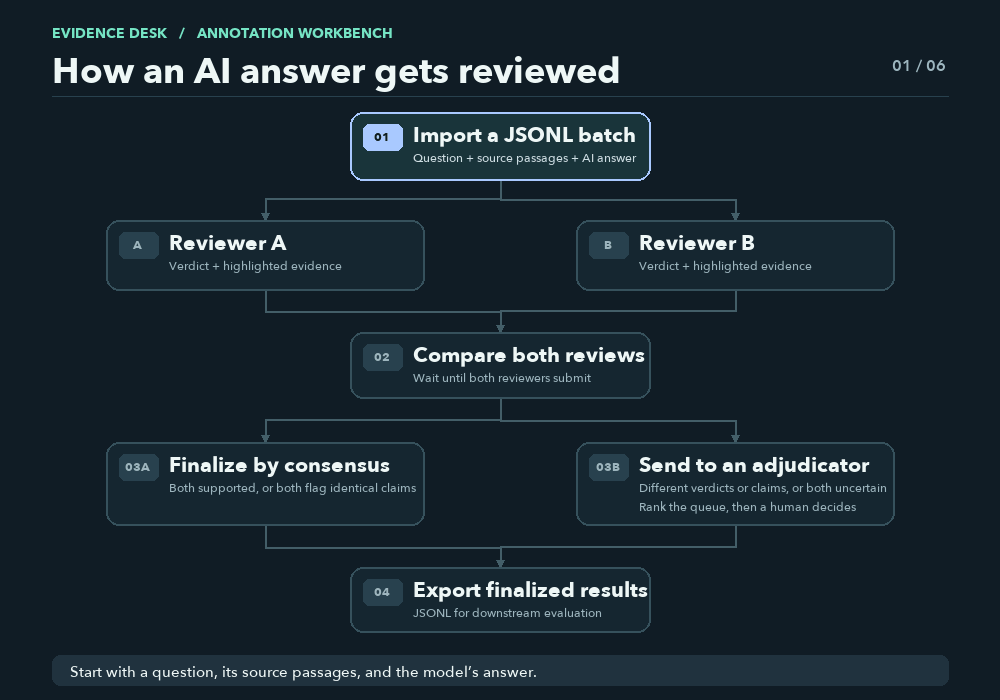

# Evidence Desk

A local annotation review workbench for evaluating whether an AI response is grounded in supplied source passages. React/TypeScript for the review interface, Python for the API, PostgreSQL for immutable review records.



[See the workflow in the actual interface](docs/Evidence-Desk-Demo.gif)

[Public benchmark: adaptive review routing, workload trade-offs, and sensitivity checks](docs/REVIEW-ROUTING-EVALUATION.md)

## Run on your Mac

Requirements: Node.js 22+, Python 3.11+, PostgreSQL command-line tools (`initdb` and `pg_ctl` on PATH), and a Python environment with psycopg2. If this checkout is already set up, run:

```sh
cd "$HOME/Documents/Project/AnnotationWorkbench"
bash scripts/run-local.sh
```

Paste **http://127.0.0.1:5194** into your browser. Press **Ctrl+C** in Terminal to stop the app and its dedicated database process. Reviews persist in this project's ignored `.local/` directory. No existing PostgreSQL cluster is used or changed; the dedicated cluster listens only on a private Unix socket. The web UI binds only to 127.0.0.1.

For a fresh copy:

```sh
npm ci
npm run build
python3 -m venv .venv
.venv/bin/python -m pip install -r requirements.txt
python3 scripts/fetch_ragtruth.py  # optional, adds the 30 reference-backed examples
ANNOTATION_PYTHON="$PWD/.venv/bin/python" bash scripts/run-local.sh
```

psycopg2 may require the PostgreSQL development headers and `pg_config` on PATH to build. Optional browser automation: `npx playwright install chromium`.

## 90-second demo

1. Choose the **Demo** batch and **DEMO-01** (digitization lab). As **Reviewer A**, select “Tuesdays through Fridays” in the answer, choose **Add selection**, mark **Unsupported**, and explain why.
2. Switch to **Reviewer B**. A’s submission is not returned by the API. Choose **Uncertain** and enter a rationale. The task enters the adjudication queue.
3. Switch to **Adjudicator**, pick **DEMO-01**, and compare both reviews. Highlight the unsupported claim, record an **Unsupported** final decision, then choose **Export JSONL**. The original decisions remain visible and are exported separately from the final decision.
4. Open a **RAGTruth QA** task to see the same interface with real benchmark content. Reference answer spans are returned only after the task is finalized and are separate from the review evidence.

The three personas are explicitly **demo personas**, not authentication. Anyone with access to the local app can switch roles. The API enforces blinding within a persona, conflicts, and reviewer permissions. Do not deploy this on a shared network without real identities, authorization and operational hardening.

## Import a local JSONL batch

Choose **Adjudicator → Import JSONL batch**, enter a batch name, and select a UTF-8 JSONL file. One task per line, up to 300 tasks and 2 MiB. Example:

```json
{"id":"opening-hours","question":"When do pickup orders open?","passages":"Pickup starts at noon.","answer":"At noon."}
```

Switch to a reviewer persona and select the new batch. Same batch and ID with identical content is skipped. Same batch and ID with different content rejects the entire upload and preserves prior reviews. Different batches may reuse external IDs. The preview stores imports locally in its dedicated PostgreSQL database and does not send them to a model or external service.

## Adaptive review budget replay

Choose **Adjudicator → Adaptive review · Budget replay**. Drag the second-review budget to compare uniform random assignment and risk-prioritized assignment with a random audit. The chart and table average both policies over the same 64 fixed seeds. Open **Why these cases were selected** to inspect one reproducible run.

- The offline fixture contains 24 authored cases. Second-review candidates already received a first pass that did not flag them as unsupported. Ranking uses only first-pass uncertainty, capped evidence count and a synthetic missing-qualifier flag. Weights are illustrative.
- A risk replay reserves roughly one in four second reviews for a uniform audit of the remaining queue (minimum one when the budget is at least two). First-pass flags are outside the incremental second-review budget.
- A miss is recovered only when the reviewed case escalates to adjudication (either verdict uncertain or a second-pass unsupported verdict) and the independent fixture outcome is unsupported. Escalations are counted separately because adjudication also has a cost. The design uses the fixture outcomes for scoring, never for selecting cases.
- The charts illustrate policy mechanics, not measured model accuracy, labor savings, or improvement on real data. The routing demo does not change the live two-review workflow. RAGTruth has reference labels but not the necessary independent first/second review history for this replay.

## Workflow and data choices

- Two independent submissions per task. A matching supported verdict, or matching unsupported verdict with identical answer selections, completes a task. Mixed verdicts, different annotated unsupported claims, or any uncertainty go to an adjudicator.
- Writes lock the task in a PostgreSQL transaction; the database allows one immutable submission per persona. Replaying the same canonical submission is safe; a different submission from the same persona is rejected.
- Evidence offsets are half-open UTF-16 code units and include the exact extracted text. The API reconstructs evidence from stored text, not a client-provided quote.
- The export includes finalized tasks only. It retains the rubric version, final verdict, rationale, selected evidence, resolution, and all original submissions. It excludes reference labels. The demo ships one fixed rubric version; no rubric editor or production accounts.
- `data/demo.jsonl` contains three authored fictional examples. The optional fixture script joins the [RAGTruth publisher's JSONL](https://github.com/ParticleMedia/RAGTruth) on `source_id` at a pinned commit and selects 30 QA test responses (15 with reference spans, 15 without) with distinct sources. The public records expose reference annotations, not the original reviewers' separate histories; demo decisions are not claims about RAGTruth's actual reviewers. Selection is deliberately stratified, not representative of population prevalence. Retain attribution and check originating source permissions before redistributing raw context in a public demo. See [the RAGTruth paper](https://aclanthology.org/2024.acl-long.585/).
- **Batch quality** in the adjudicator view separates synthetic and RAGTruth work, and groups each by rubric. The disagreement rate is (finalized verdict splits + finalized claim-span splits) ÷ all finalized tasks; both-uncertain is a distinct reason, not a disagreement. Pending pairs/adjudications are operational counts, not part of that denominator. A batch with no finalized tasks shows “—”, not 0%.
- Queue, submit guards, and reporting share the PostgreSQL `review_progress` view. The endpoint aggregates with conditional counts and keeps reviewer-level data out of the metrics response.
- Adjudication triage uses interval intersection-over-union (sorted, merged answer selections with a two-pointer scan) to rank claim-span conflicts. Verdict splits come first, then non-overlapping claim selections, then both-uncertain, then overlapping claims in increasing overlap order. The queue displays the reason and any overlap percentage. Ranking is not a semantic-equivalence test and never bypasses human adjudication.
- No model calls, API keys, third-party network calls at runtime, or Temporal.

## Verification

```sh
npm run build
node --experimental-strip-types --test tests/review-budget.test.mjs
python3 scripts/fetch_ragtruth.py
bash scripts/check-local.sh            # local PostgreSQL + API
bash scripts/check-local.sh --browser  # plus three isolated Chromium sessions
```

Tests use a disposable local cluster and test port; they do not touch normal preview reviews.
